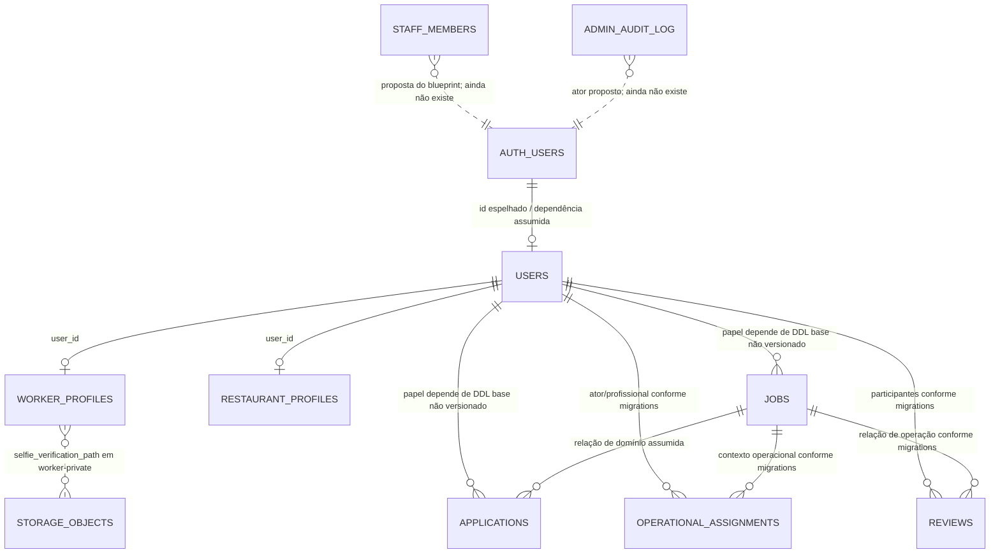

# ExtraChef — ERD Canônico (Provisório)

**Status: NÃO CANÔNICO — dependências inferidas das migrations**

Um ERD fiel do banco remoto não pode ser produzido com as evidências atuais: não há DDL de catálogo nem export de schema. Este arquivo registra somente relações/referências demonstradas pelo histórico versionado e não pretende listar todas as colunas, chaves ou constraints.

### Grau de evidência

| Relação/objeto | Evidência | Status |
|---|---|---|
| `worker_profiles.user_id → users.id` | DDL de `20261014050000_profiles_and_geo.sql` | ✅ Referência versionada |
| `restaurant_profiles.user_id → users.id` | DDL de `20261014050000_profiles_and_geo.sql` | ✅ Referência versionada |
| Relações de `jobs`/`applications` | Migrations de domínio fazem uso e impõem regras sobre essas tabelas, mas DDL inicial ausente | ⚠ Estrutura/constraints exatas desconhecidas |
| `operational_assignments`, `reviews` e usuários/vagas | Migrations de confiança operacional/reviews | ⚠ Confirmar FK e cardinalidade no catálogo remoto |
| Storage de selfie | Path guardado em `worker_profiles.selfie_verification_path`; objeto em `storage.objects`/`worker-private` | ✅ Dependência lógica; não é FK relacional |
| `staff_members`, `admin_audit_log` | Apenas arquitetura proposta em documentos | ❌ Ainda não existem no código/migrations |

O modelo final deve ser regenerado/revisado a partir do DDL do ambiente, incluindo todas as FKs, cardinalidades, constraints e tabelas de apoio. Não usar este diagrama provisório para gerar migrations.
